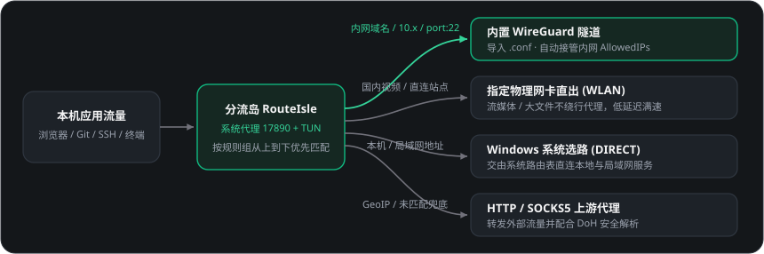
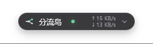
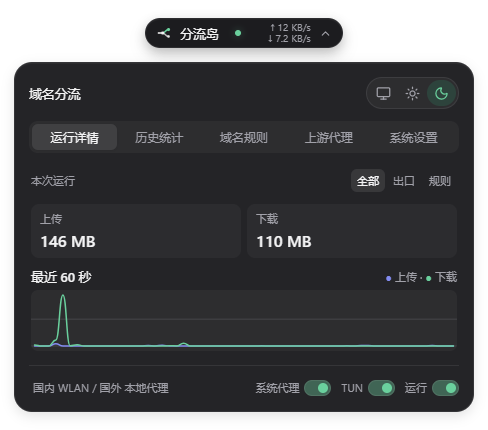
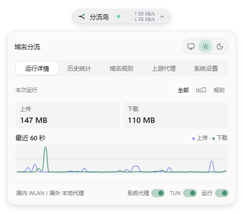
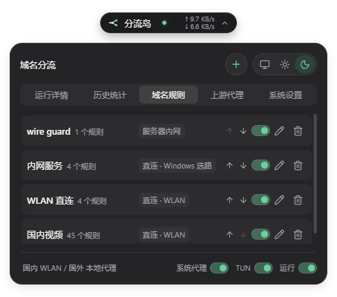
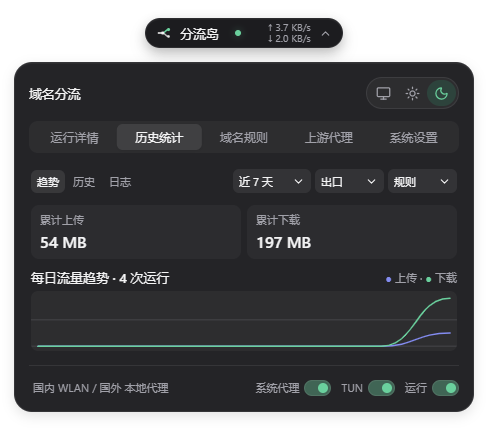
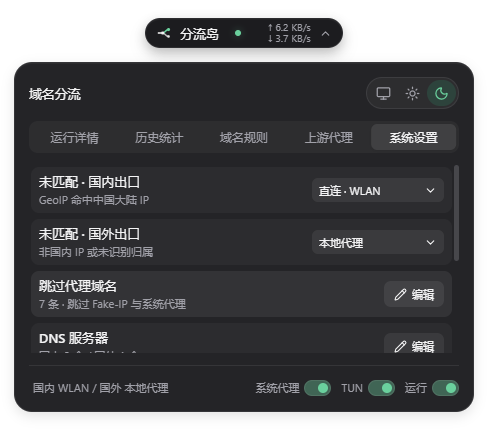
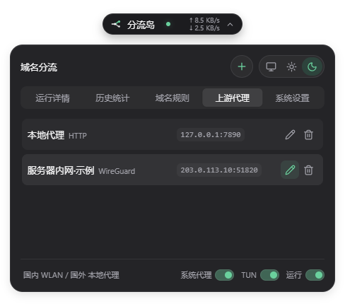

# 分流岛 · RouteIsle

> **Windows 桌面悬浮胶囊网络分流工具** —— 让公司内网、WireGuard 隧道、物理网卡直连与上游代理各走其道，一次配置，同时在线，不再反复开关切换。

---

## 为什么需要分流岛？（解决的实际痛点）

日常开发和办公中，多网络环境并存常常让人抓狂：

| 常见痛点 | 传统做法的麻烦 | 分流岛的解法 |
| --- | --- | --- |
| **开代理就断内网，关代理又连不上外网** | 访问公司 Gitea / OA / 内网服务时要手动关代理，拉外部依赖或查资料时再打开，一天切十几次。 | 按域名、IP 段、端口、进程精细分流，内网与外网流量自动分道并行。 |
| **WireGuard 与代理 TUN 虚拟网卡打架** | 同时开系统代理/TUN 和独立 WireGuard 客户端，路由表冲突、SSH 握手断开、DNS 解析串线。 | **内置 WireGuard 引擎**，直接导入 `.conf`，自动提取内网 `AllowedIPs` 网段并绑定物理网卡防回环。 |
| **视频 / 大流量白白绕行代理** | 刷国内视频或下载大文件走代理不仅卡顿，还浪费宝贵代理流量。 | 内置常用国内流媒体与直连规则组，一键指定走 **WLAN / 物理网卡直出**。 |
| **手写 YAML 规则门槛高、易写错** | 修改一条规则要翻半天配置文件、记正则/通配符语法，还要重启内核。 | 可视化规则表格 + **7 种快捷预设**（支持直接粘贴 URL），支持拖拽/上下排序，修改即热重载。 |

---

## 工作原理一览

<p align="center">
  
</p>

---

## 界面预览

<p align="center">
  
</p>

| 深色模式 · 运行详情 | 浅色模式 · 运行详情 |
| --- | --- |
|  |  |

| 域名规则（支持排序与预设） | 历史统计与流量趋势 |
| --- | --- |
|  |  |

| 系统设置（GeoIP / 绕过 / DNS） | 上游代理（HTTP / SOCKS5 / WireGuard / 网卡） |
| --- | --- |
|  |  |

---

## 核心特性

- **极简悬浮胶囊**：常驻桌面并可自动吸附四边与四角；实时显示运行状态与上下行速率，点击展开紧凑控制面板，不占任务栏空间。
- **多出口同台协同**：
  - 支持 **HTTP / SOCKS5** 上游代理；
  - 支持 **内置 WireGuard**（导入 `.conf` 自动解析私钥/节点/MTU/自定义 DNS，并自动接管非全路由 `AllowedIPs`）；
  - 支持 **指定本机网卡直出**，内置本机监听端口与网卡扫描。
- **零门槛规则构建与排序**：
  - 规则组支持 `↑ / ↓` 排序，**排在最前的规则组最先匹配**；
  - 内置规则小表格与预设构建器：支持 `*.后缀`、`*泛域名*`、`前缀.*`、`精确域名`、`IP/CIDR`、`port:端口/范围`、`proc:进程名`，粘贴完整 URL 自动提取域名。
- **TUN 接管与智能 DNS**：
  - 一键切换「系统代理」与「TUN 全局接管」（支持计划任务免重复 UAC 提权）；
  - 支持自定义国内 / 国外 DNS，内网 WireGuard 自动防 Fake-IP 阻塞，确保内网域名与 `ssh` 正常连通。
- **实时可观测性**：提供 60 秒实时速率趋势图、按出口与规则组流量汇总、最近 30 次运行历史及按日期检索的连接日志。

---

## 快速开始（源码开发）

### 1. 环境准备

- Windows 10 / 11（x64）
- [Node.js](https://nodejs.org/)（18+）
- [Rust](https://www.rust-lang.org/)（含 Cargo）与 Visual Studio C++ Build Tools / Windows SDK
- WebView2 Runtime（Windows 10/11 通常已内置）

### 2. 安装依赖并获取内核

仓库不包含体积较大的二进制内核文件（`ApexCore.exe` 已在 `.gitignore` 中忽略），首次运行或打包前需先准备内核：

```powershell
# 1. 安装前端依赖
npm install

# 2. 自动下载已验证兼容的 Mihomo 内核 (v1.19.29) 到根目录 ApexCore.exe
npm run fetch:core
```

> **手动获取内核**：如果网络无法直接下载，可前往 [MetaCubeX/mihomo v1.19.29](https://github.com/MetaCubeX/mihomo/releases/tag/v1.19.29) 下载 `mihomo-windows-amd64-compatible-v1.19.29.zip`（脚本默认锁定 `v1.19.29`，避免新版本变更带来兼容性问题），解压后将 `.exe` 重命名为 `ApexCore.exe` 放到项目根目录。
>
> GeoIP 数据库 `Country.mmdb` 已随仓库提供，也可在程序「系统设置」中在线更新。

### 3. 启动桌面预览

```powershell
# 启动 Tauri 桌面端开发预览（推荐）
npm run desktop
```

仅需在浏览器中预览界面与模拟数据时，可运行：

```powershell
npm run dev
```

### 4. 构建安装包

```powershell
# 构建前端产物并打包 Windows 安装程序（NSIS / MSI）
npm run build:desktop
```

构建产物输出在 `src-tauri/target/release/bundle/` 目录下。

---

## 规则语法速查

在「域名规则 → 规则组设置」中可通过快捷预设一键生成，也支持以下语法：

| 类型 | 示例 | 说明 |
| --- | --- | --- |
| 后缀匹配 | `*.example.com` | 匹配主域名及所有子域名 |
| 泛域名 / 通配符 | `*keyword*` / `cdn-*.example.com` | 域名通配符匹配 |
| 前缀匹配 | `api.*` | 匹配指定前缀域名 |
| 精确匹配 | `git.example.com` | 精确匹配单个域名 |
| IP / CIDR | `10.10.0.0/16` / `10.10.1.5` | 匹配 IP 或网段（单 IP 自动补全 `/32` 或 `/128`） |
| 目标端口 | `port:22` / `port:8000-9000` | 按目标端口或端口范围分流 |
| 进程名 | `proc:ssh.exe` | 按进程文件名分流（需开启 TUN） |

---

## 数据与技术栈

- **运行时数据目录**：`%APPDATA%\local.splitproxy.island\`（存放 `proxy-rules.json` 与 `logs/`，不污染源码仓库）。
- **技术栈**：Tauri 2（Rust） · Vue 3 · Vite · UnoCSS · Reka UI · Lucide Icons · Mihomo (`ApexCore.exe`)
